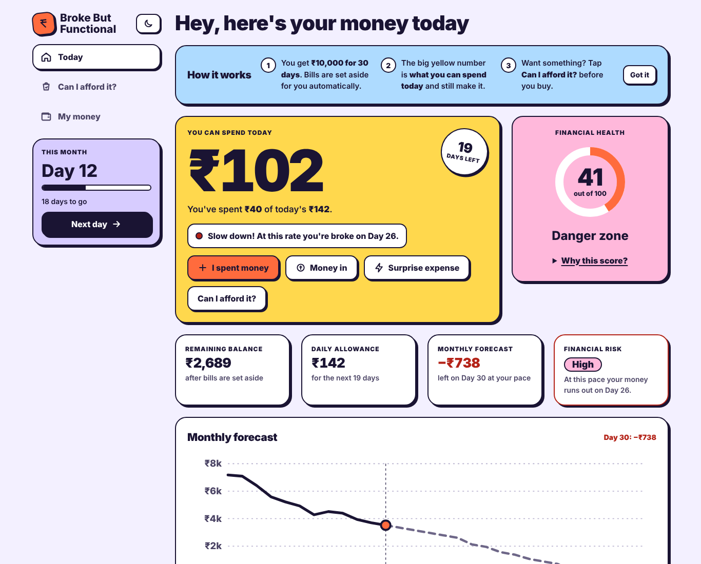
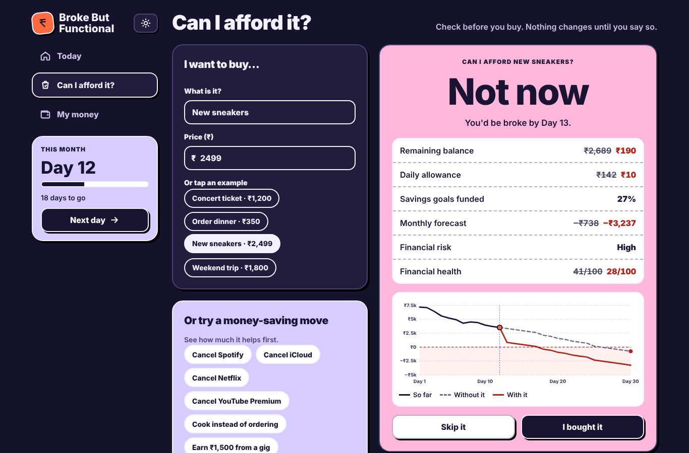
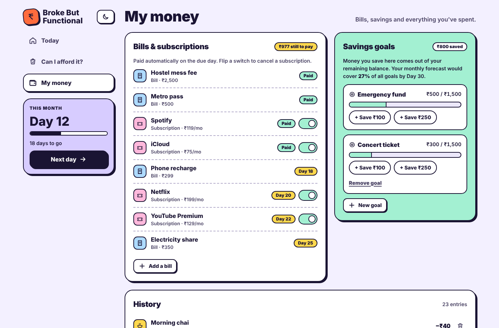
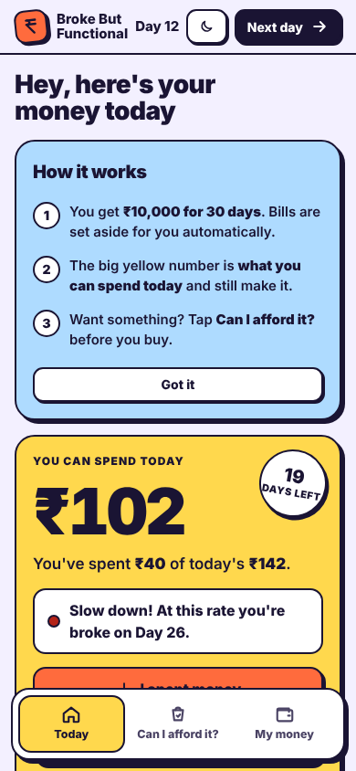

# Broke But Functional — Survive the Month

> A Gen Z personal finance app for living on **₹10,000 for 30 days**: see what you can spend today, and simulate any decision before you make it.

**Live demo:** https://brokebutfuncional.vercel.app · **Stack:** React 18 · TypeScript (strict) · Vite · Vitest + Testing Library · ESLint 9 · Vercel



## Table of contents

- [Features](#features)
- [How the numbers connect](#how-the-numbers-connect)
- [Getting started](#getting-started)
- [Scripts](#scripts)
- [Project structure](#project-structure)
- [Architecture](#architecture)
- [Accessibility](#accessibility)
- [Security](#security)
- [Performance](#performance)
- [Testing](#testing)
- [Screenshots](#screenshots)
- [Deployment](#deployment)
- [Contributing](#contributing) · [Changelog](CHANGELOG.md) · [License](#license)

## Features

Every requirement in the challenge brief maps to a visible feature:

| Brief requirement | Feature |
|---|---|
| Limited ₹10,000 budget over 30 days | Day counter with **Next day**, month roll-over, leftover money carried forward |
| **Income** | **Money in** button (pocket money, gigs), income moves in the simulator |
| **Balance** & **spending** | **Remaining balance** tile, money split bar, category breakdown, 30-day calendar, history |
| **Commitments** | Bills auto-paid on their due day; the money is set aside in advance |
| **Subscriptions** | Accessible on/off switches; cancelling frees money immediately |
| **Savings goals** | Create, fund and remove goals; shows how much your forecast surplus covers |
| **Unexpected expenses** | **Surprise expense** button and "unexpected" toggle, kept out of your usual pace |
| **Financial risk** | Low / Medium / High risk badge with a plain-language reason |
| **Financial health** | 0–100 score from five weighted factors, explained under "Why this score?" |
| **Simulate decisions before taking them** | **Can I afford it?** shows before → after for **remaining balance, daily allowance, savings goals, monthly forecast, financial risk and financial health**, plus a before/after forecast chart. Nothing changes until you confirm |
| Visible, interconnected consequences | One pure engine (`computeSnapshot`) feeds every screen; dialogs preview the new allowance and forecast as you type; every action can be undone |
| Consumer-grade product feel | Light/dark themes, responsive desktop/phone layouts, toasts with Undo, guided "How it works" onboarding |

## How the numbers connect

```
balance            = budget + income − spending − savings
remaining balance  = balance − bills still due this month
daily allowance    = remaining balance ÷ days left (including today)
usual daily spend  = everyday spending so far ÷ days passed − habit savings
monthly forecast   = remaining balance − usual daily spend × remaining days
financial risk     = High if money runs out before Day 30, Medium if the margin is thin, else Low
goals funded       = (goal savings + forecast surplus) ÷ total goal targets
financial health   = month-end (35) + pace vs allowance (25) + saving (20) + subscriptions (10) + emergency fund (10)
```

## Getting started

Requirements: **Node.js 18.18+** and npm.

```bash
git clone https://github.com/Shrinidhiskaranth/Brokebutfuncional.git
cd Brokebutfuncional
npm install
npm run dev          # http://localhost:5173
```

The app opens on an example student month (Day 12) so every feature has data. Use **My money → Start my own month** to begin from Day 1.

## Scripts

| Command | What it does |
|---|---|
| `npm run dev` | Start the Vite dev server |
| `npm run build` | Type-check, then build to `dist/` |
| `npm run preview` | Serve the production build locally |
| `npm run typecheck` | `tsc --noEmit` with strict settings |
| `npm run lint` | ESLint with zero warnings allowed |
| `npm test` | Run all Vitest unit, component and integration tests |
| `npm run check` | Typecheck + lint + tests (run before every commit) |

## Project structure

```
src/
├── App.tsx                 App composition: navigation, lazy pages, dialogs
├── main.tsx                Entry: StrictMode, ErrorBoundary, providers
├── constants/              Budget rules, categories, limits, navigation tabs
├── types/                  Shared domain types (MonthState, Snapshot, Decision…)
├── domain/                 Pure business logic: no React, fully unit-tested
│   ├── finance.ts          Snapshot, risk, health, forecast, decisions, verdicts
│   └── months.ts           Example month, fresh month, month roll-over
├── state/reducer.ts        Typed actions, re-validated payloads, undo history
├── context/                FinanceProvider and ToastProvider (React context)
├── hooks/                  useFinance, useToast, useTheme, useHashTab
├── services/storage.ts     Schema-validated localStorage persistence
├── utils/                  Formatting, sanitisation, ids, focus helpers
├── features/afford/        Draft model for the "Can I afford it?" simulator
├── components/
│   ├── charts/             ForecastChart (accessible SVG)
│   ├── dashboard/          Hero, metrics, health, forecast, calendar, categories
│   ├── dialogs/            Spend / income dialog, confirmation dialog
│   ├── layout/             AppShell (sidebar, top bar, bottom tabs)
│   ├── ui/                 Modal, Switch, Chip, Icon, TransactionList, PageSkeleton
│   └── ErrorBoundary.tsx   Recovery screen for unexpected errors
├── pages/                  TodayPage, AffordPage, MoneyPage
├── styles/app.css          Design tokens, light/dark themes, responsive rules
└── test/                   Test setup and fixtures
```

## Architecture

Data flows one way: **UI event → `dispatch(action)` → pure reducer → `computeSnapshot()` → render.** Components never calculate money themselves; they read one memoised snapshot. See [docs/ARCHITECTURE.md](docs/ARCHITECTURE.md) for diagrams and design decisions.

## Accessibility

- Semantic landmarks, one `h1` per page, a skip link, and focus moved to the page heading after navigation.
- Every field is labelled. Errors use `aria-invalid`, `aria-describedby` and `role="alert"`, and focus moves to the first invalid field.
- Dialogs use `role="dialog"` or `alertdialog` with `aria-modal`. Focus moves in and is trapped, **Escape** closes the dialog, focus returns to the opener, and the background is made `inert`.
- `role="switch"` + `aria-checked`, `aria-pressed` chips, `aria-current` navigation, `role="progressbar"` goals.
- Charts have text alternatives: the forecast chart, health ring and money split use `role="img"` labels, and calendar days have screen-reader text. Updates are announced through `aria-live`.
- WCAG AA contrast in **both light and dark themes**, visible focus rings, 38–44px touch targets, and `prefers-reduced-motion` support.

## Security

- **Input:** `utils/sanitize.ts` strips control, zero-width and bidi characters and angle brackets, and caps length. Amounts must be whole rupees ≤ ₹10,00,000. Days are 1–30. Categories are allow-listed.
- **Defence in depth:** the reducer re-validates every payload, so invalid data never reaches state.
- **Output:** React escapes all text. There is no `dangerouslySetInnerHTML`, `eval` or `innerHTML`.
- **Storage:** `services/storage.ts` treats `localStorage` as untrusted: it parses in `try/catch`, validates every field and discards anything off-schema.
- **HTTP headers** (`vercel.json`): strict CSP, HSTS, `X-Content-Type-Options`, `X-Frame-Options`, `Referrer-Policy`, `Permissions-Policy` and COOP.
- **Dependencies:** a small, well-known set. `npm audit` reports 0 vulnerabilities. Fonts are self-hosted.

## Performance

- **Code splitting:** the secondary pages and dialogs load with `React.lazy` + `Suspense`, behind a space-reserving skeleton (no layout shift).
- **Memoisation:** the snapshot is computed once per change (`useMemo`), dashboard cards and the chart are wrapped in `React.memo`, and handlers are stable via `useCallback`.
- **Rendering:** below-the-fold sections use `content-visibility: auto`. The forecast chart is plain SVG with no chart library.
- **Assets:** self-hosted fonts with `font-display: swap`, one small CSS file, and long-term caching for hashed assets.

## Testing

`npm test` runs Vitest (jsdom) with Testing Library:

- **Domain:** allowance, forecast, run-out day, risk, goal funding, health score, bills, every decision and verdict.
- **State:** every reducer action (including income and goals), invalid payloads, roll-over, undo, and storage tampering or failures.
- **Utils:** sanitisation with hostile and edge-case inputs.
- **Components:** Switch, Chip, and the Modal focus trap and Escape.
- **Integration (`App.test.tsx`):** logging a spend and undoing it, income, validation, Escape focus return, XSS rendered as text, surprise expenses, next day, the theme toggle, the six-measure simulator, saving moves, subscriptions, bills, goals and reset confirmation.

## Screenshots

| Today (light) | Can I afford it? (dark) |
|---|---|
|  |  |

| My money | Phone |
|---|---|
|  |  |

## Deployment

The app is deployed on **Vercel**. Pushing to `main` builds with `npm run build` and serves `dist/`, as configured in `vercel.json`, which also sets the security headers.

## Contributing

See [CONTRIBUTING.md](CONTRIBUTING.md). In short: run `npm run check` before every commit, and keep business logic in `src/domain` with tests.

## License

[MIT](LICENSE)
