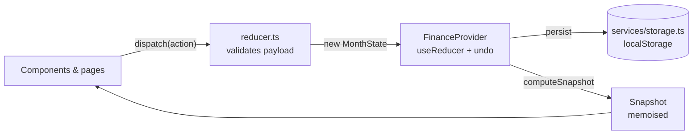

# Architecture

## Goals

1. **One source of truth.** Every number on screen comes from one pure function, so the screens always agree.
2. **Safe by default.** Untrusted input is validated at the edge, again in the reducer, and again when read from storage.
3. **Testable.** Business logic has no React or browser dependencies.

## Data flow

- `MonthState` is the only stored data: transactions, bills, goals, habits, the day and the budget.
- `Snapshot` is derived every time state changes: remaining balance, daily allowance, monthly forecast, risk, goal funding, health score and calendar data.
- The **simulator** ("Can I afford it?") applies a `Decision` to a *copy* of the state, computes a second snapshot and compares the two. Real state changes only when the user confirms.

## Layers

| Layer | Folder | Depends on | Notes |
|---|---|---|---|
| Types & constants | `types/`, `constants/` | nothing | Shared vocabulary |
| Utilities | `utils/` | constants | Formatting, sanitisation, ids, focus maths |
| Domain | `domain/` | types, utils | Pure functions: the money engine |
| State | `state/` | domain, utils | Reducer + undo history |
| Services | `services/` | types, utils | Persistence with schema validation |
| Context & hooks | `context/`, `hooks/` | state, services | React wiring |
| UI | `components/`, `pages/`, `features/` | hooks, domain | Presentation only |

## Key decisions

- **No routing library.** Three tabs are kept in the URL hash by `useHashTab`, which keeps the bundle small and still supports deep links and the back button.
- **No chart library.** `ForecastChart` is hand-written SVG (around 120 lines) with a full text alternative.
- **Code splitting.** The Today page loads eagerly because it is the landing view. The other pages and dialogs are `React.lazy` chunks.
- **Undo** is a single-step history in the reducer wrapper. It is simple, predictable and covered by tests.
- **Theming** uses CSS custom properties. Bright "sticker" cards keep dark text in both themes, so contrast never depends on the theme.

## Financial model

See [How the numbers connect](../README.md#how-the-numbers-connect). Surprise expenses and one-off purchases reduce your balance but do not change your *usual* daily spend, so a single bad day doesn't distort the forecast.
